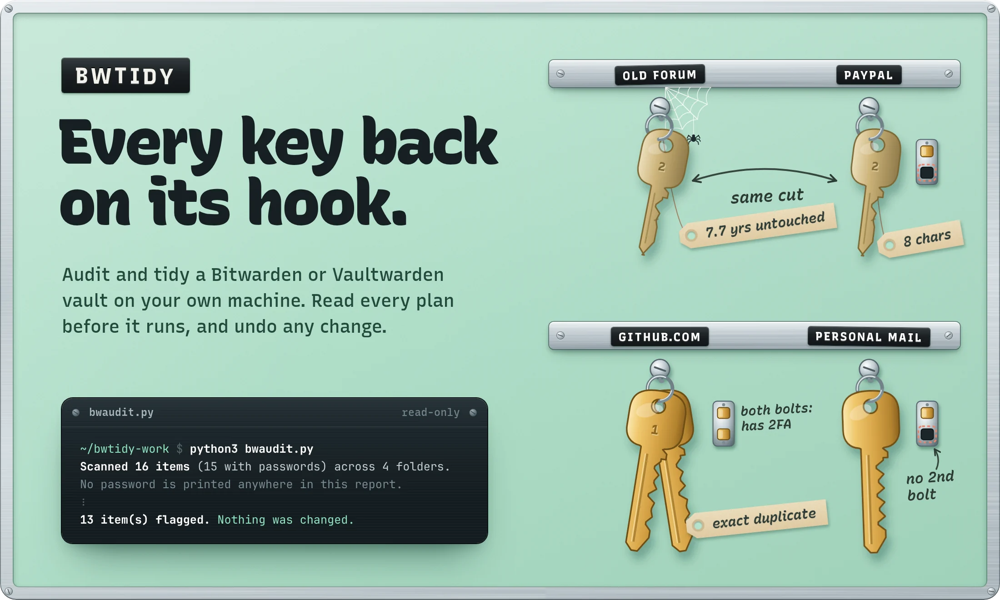
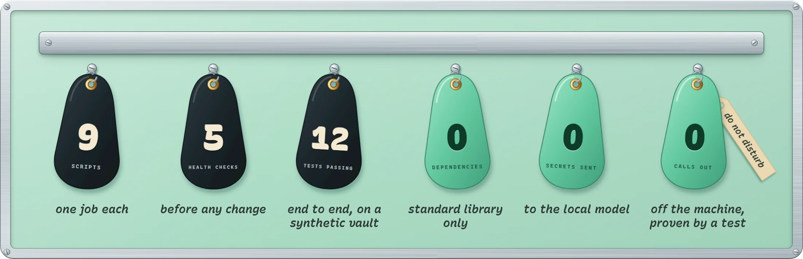
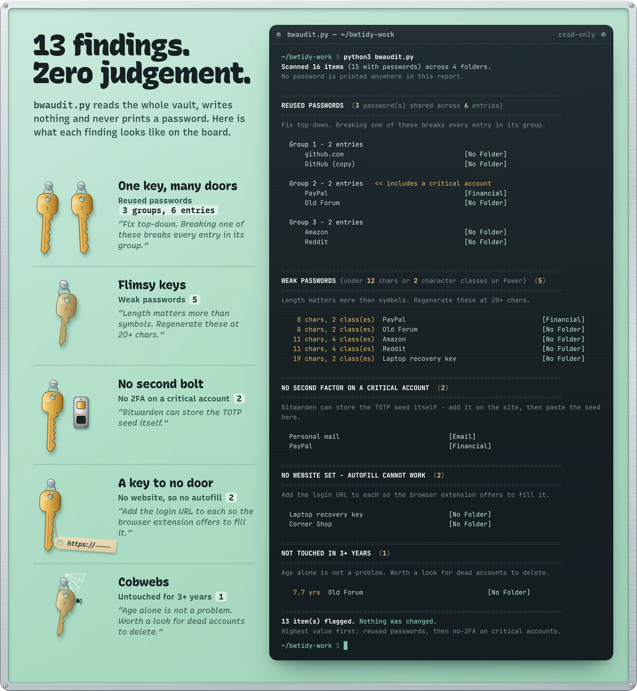
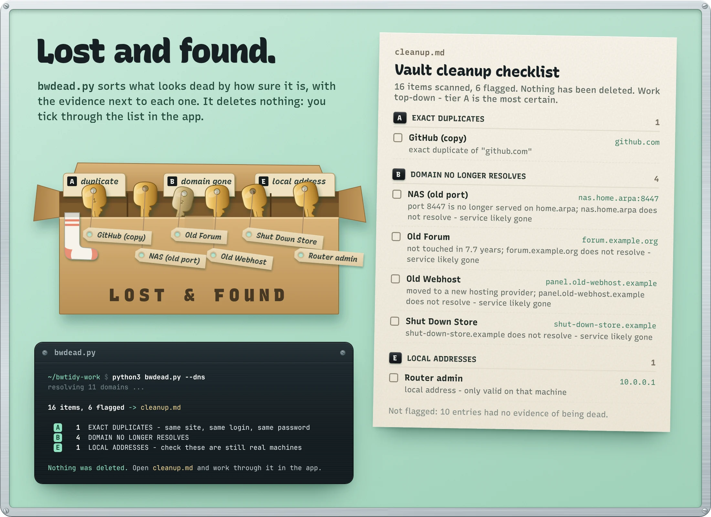
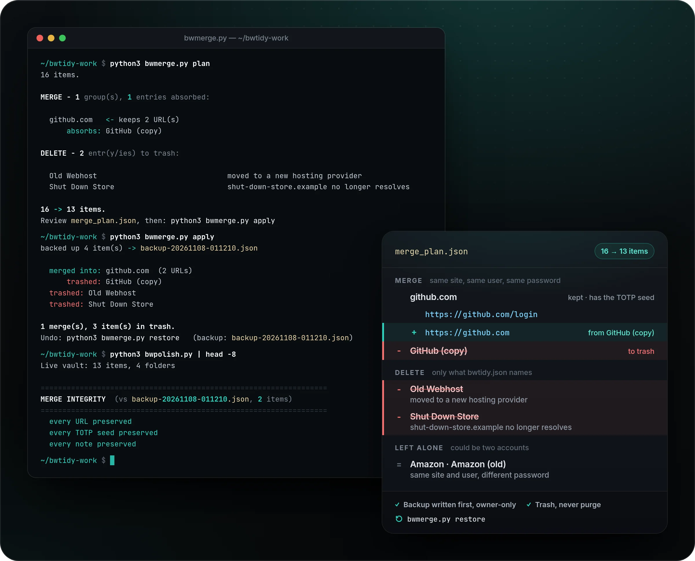
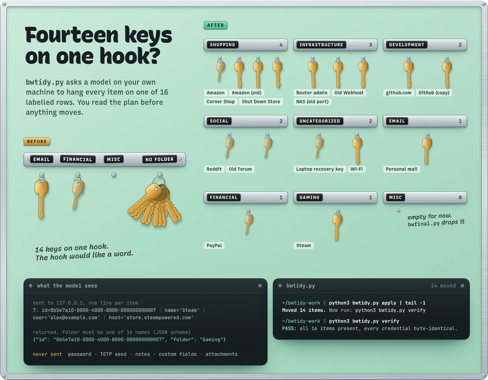
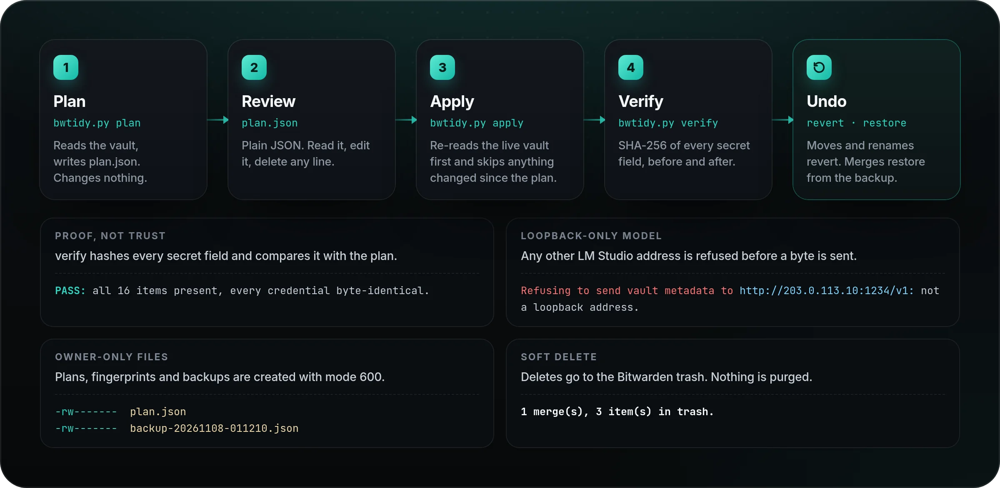
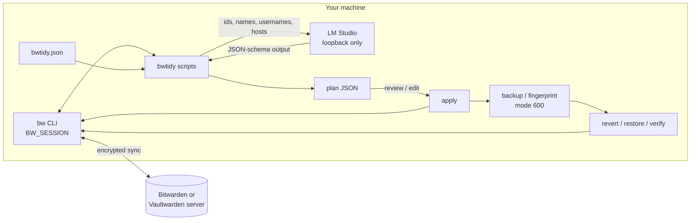

<a href="#quickstart">
  <picture>
    <source media="(max-width: 700px)" srcset="docs/readme/hero-mobile.webp" />
    
  </picture>
</a>

<p align="center">
  <a href="#quickstart"><b>Quickstart</b></a>
  &nbsp;·&nbsp;
  <a href="#try-it-on-a-fake-vault">Try it on a fake vault</a>
  &nbsp;·&nbsp;
  <a href="#every-change-has-an-undo">Safety model</a>
  &nbsp;·&nbsp;
  <a href="#under-the-hood">How it works</a>
  &nbsp;·&nbsp;
  <a href="https://gallowforge.github.io">Portfolio</a>
</p>

<p align="center">
  <a href="https://github.com/gallowforge/bwtidy/actions/workflows/ci.yml"></a>
  
  
  
  
  
</p>

<br />

A password vault that has grown for years is a drawer of keys nobody has sorted: the same password on your bank and an old forum, logins with no second factor, three copies of one account, services that shut down long ago. None of it shows in the app. Fixing it by hand is slow, and the tools that promise to help want your vault on someone else's computer.

**bwtidy audits and tidies a Bitwarden or Vaultwarden vault on your own machine.** It finds reused and weak passwords, missing 2FA, duplicates and dead entries, and has a local model propose folders and names. Every change is a plan you can read first, applied only when you say so, and reversible afterwards. It is nine small Python scripts on the standard library and the official `bw` CLI.

<picture>
  <source media="(max-width: 700px)" srcset="docs/readme/numbers-mobile.webp" />
  
</picture>

<br />

## Know what to fix first

`bwaudit.py` reads the whole vault and prints one report, highest value first. It needs no model and no network, writes nothing, and never prints a password.

- **Reused passwords, grouped.** Passwords are compared as SHA-256 hashes in memory. Each group lists every entry that breaks if one leaks, and flags the groups that include a critical account.
- **Weak passwords and missing 2FA.** Anything under 12 characters or with two character classes or fewer, and every login in Financial, Email, Infrastructure or Government & Utilities without a TOTP seed.
- **The quiet problems.** Logins with no website, so autofill can never offer them, and entries untouched for three years or more.
- **Duplicates next.** `bwdupes.py` groups entries by registrable domain and normalised username, and tiers each group by how sure the match is.

<picture>
  <source media="(max-width: 700px)" srcset="docs/readme/audit-mobile.webp" />
  
</picture>

## Find the dead weight

`bwdead.py` builds a ranked deletion checklist in `cleanup.md`, with the evidence next to every entry. It deletes nothing; you tick through it in the Bitwarden app.

- **Ranked by certainty.** Tier A is exact duplicates, B is domains that no longer resolve, C is services you have moved off or ports your private host no longer serves, D is entries untouched for years, E is local addresses.
- **Your knowledge, not hard-coded guesses.** Decommissioned services, dead domains and the ports still served on your private host live in `bwtidy.json`, never in the code.
- **DNS only when you ask.** `--dns` does one lookup per unique domain through your own resolver. Without it, nothing is looked up.

<picture>
  <source media="(max-width: 700px)" srcset="docs/readme/dead-mobile.webp" />
  
</picture>

## Merge duplicates without losing a byte

`bwmerge.py` folds entries that are provably one account into one, and trashes only what your config names as dead.

- **Provably one account.** Same registrable domain, same username, same password, and no differing ports. The richest entry survives and keeps every URL, so autofill still works everywhere.
- **Backup first.** Every affected item is written to an owner-only backup before the first change, and deletes go to the Bitwarden trash, never a purge.
- **Proof afterwards.** `bwpolish.py` checks that every URL, TOTP seed and note from before the merge still exists, then lists what is left to tidy.
- **One command back.** `bwmerge.py restore` puts every item back from the newest backup.

<picture>
  <source media="(max-width: 700px)" srcset="docs/readme/merge-mobile.webp" />
  
</picture>

## Let a local model sort the folders

`bwtidy.py` asks a model running in LM Studio on your own machine to place every item in one of 16 folders, then shows you the plan before anything moves.

- **Constrained output.** The reply must match a JSON schema whose folder field is an enum of the 16 allowed names. Incomplete batches are retried, then split, and anything still unclear goes to Uncategorized.
- **The model sees four fields.** For folders: item id, name, username and hostname. Never a password, TOTP seed, note, custom field or attachment, and a test checks every request.
- **Cleaner names too.** `bwrename.py` proposes a clean name per brand group, and code, not the model, makes names unique inside a brand. `bwfix.py` repairs a rename plan without calling the model again.
- **Byte-for-byte proof.** `bwtidy.py verify` compares a fingerprint of every secret field before and after, and fails if one byte changed.

<picture>
  <source media="(max-width: 700px)" srcset="docs/readme/folders-mobile.webp" />
  
</picture>

The folder demo uses the deterministic stand-in for LM Studio from the test suite, which answers with keyword rules but speaks the same API. With LM Studio itself, the default model is Mistral Small 3.2 24B.

## Every change has an undo

Nothing writes to your vault without a plan you can read first, and every write can be walked back.

- **Plan, review, apply.** Each writing script has a `plan` step that changes nothing and writes plain JSON you can edit. `apply` re-reads the live vault first: items deleted since the plan are skipped, renames skip items renamed in the meantime, and a merge aborts if any planned item is gone.
- **Undo for each kind of change.** Folder moves and renames have `revert`. Merges and the final pass are restored from their backups.
- **Private by construction.** Every file the scripts write is created with mode 600. The model must be on `localhost` or a loopback address, or the script exits before sending a byte.

<picture>
  <source media="(max-width: 700px)" srcset="docs/readme/flow-mobile.webp" />
  
</picture>

Every name, number and terminal line in these images is real output from running the scripts on the synthetic vault in [`examples/`](examples), through the fake `bw` and the stand-in model in [`tests/`](tests). The key board is drawn in code from that output: keys that share a password share a cut, weak passwords are flimsy keys, and every item is the same key in every picture. Regenerate the images with `python3 scripts/readme_visuals.py`.

## Why it is different

|                    | bwtidy                                                   | Tidying by hand in the app             |
| ------------------ | -------------------------------------------------------- | -------------------------------------- |
| Finding problems   | One read-only report, grouped and ranked                 | Open items one by one and remember     |
| Duplicates         | Merged only when provably one account, URLs kept         | Delete one and hope it was the copy    |
| Dead entries       | A ranked checklist with the evidence                     | Memory                                 |
| Folders and names  | Proposed by a local model, reviewed as JSON              | Drag and rename, one at a time         |
| Mistakes           | `revert`, `restore`, and `verify` to prove it            | None                                   |
| Your vault data    | Stays on your machine; the model is on loopback          | Cloud AI helpers need it sent to them  |

## Quickstart

Requirements: Python 3.10 or newer, the [Bitwarden CLI](https://bitwarden.com/help/cli/), and [LM Studio](https://lmstudio.ai/) with its local server running for the model steps. The audit, duplicate, dead-entry and merge scripts need no model.

```sh
git clone https://github.com/gallowforge/bwtidy ~/bwtidy
mkdir -p ~/bwtidy-work && cd ~/bwtidy-work          # plans and backups land here

bw config server https://vault.example.com          # Vaultwarden only
bw login
export BW_SESSION="$(bw unlock --raw)"

cp ~/bwtidy/examples/bwtidy.example.json bwtidy.json   # optional, edit to taste
python3 ~/bwtidy/bwaudit.py                          # read-only health report
```

The model defaults to `mistralai_mistral-small-3.2-24b-instruct-2506`. Set `LMSTUDIO_MODEL` to use another model loaded in LM Studio, and `LMSTUDIO_URL` if the server is not on `http://localhost:1234/v1`.

A typical pass: `bwaudit` and `bwdupes` to see the state, `bwtidy plan`, `apply`, `verify`, then `bwrename plan` (and `bwfix` if names need repair) and `apply`, then `bwmerge plan` and `apply`, `bwpolish`, and finally `bwfinal plan` and `apply`.

### Try it on a fake vault

The test fixtures include a fake `bw` and a stand-in LM Studio, so the whole workflow runs against the synthetic vault in `examples/` without touching a real one:

```sh
cd "$(mktemp -d)"
cp ~/bwtidy/examples/sample-vault.json vault.json
cp ~/bwtidy/examples/bwtidy.example.json bwtidy.json
export PATH="$HOME/bwtidy/tests/bin:$PATH" BW_SESSION=demo BW_FAKE_VAULT="$PWD/vault.json"
python3 ~/bwtidy/tests/fake_lmstudio.py 1234 &
python3 ~/bwtidy/bwaudit.py
python3 ~/bwtidy/bwtidy.py plan && python3 ~/bwtidy/bwtidy.py apply && python3 ~/bwtidy/bwtidy.py verify
```

## Commands

Run them from a working directory; plans, fingerprints and backups are written there.

| Script | Writes to vault | What it does |
| --- | --- | --- |
| `bwaudit.py` | no | Reused passwords, weak passwords, critical accounts without TOTP, logins without a URL, items untouched for 3+ years. No model. |
| `bwdupes.py` | no | Duplicate report grouped by registrable domain and normalised username, tiered by confidence. |
| `bwdead.py [--dns]` | no | Ranked deletion checklist written to `cleanup.md`: exact duplicates, dead domains, decommissioned services, stale items, local addresses. |
| `bwtidy.py plan \| apply \| verify \| revert` | yes | The model assigns every item to one of a fixed set of folders (JSON-schema constrained output). `verify` proves credentials are unchanged. |
| `bwrename.py plan \| apply \| revert` | yes | The model proposes clean names per brand group; uniqueness inside a brand is enforced by code. Only `name` is written. |
| `bwfix.py [--dry]` | no | Deterministic repair of `rename_plan.json`: strips echoed or truncated suffixes and re-disambiguates using only attributes that differ. |
| `bwmerge.py plan [--dns] \| apply \| restore [backup]` | yes | Merges entries that are provably one account; the richest entry keeps all URLs. Trashes only configured dead domains and decommissioned services. |
| `bwfinal.py plan \| apply` | yes | Reclassifies what is still in Uncategorized, adds configured URLs, converts configured non-logins to Secure Notes, drops empty folders. Backed up; undo with `bwmerge.py restore backup-final-<stamp>.json`. |
| `bwpolish.py [backup]` | no | After a merge: proves every URL, TOTP seed and note still exists, then lists remaining cosmetic issues. |

### Configuration

Vault-specific knowledge lives in `./bwtidy.json` (or `$BWTIDY_CONFIG`), never in the code. Every key is optional, and unknown keys are rejected.

| Key | Used by | Meaning |
| --- | --- | --- |
| `decommissioned` | bwdead, bwmerge | `{"substring": "reason"}` matched against item name and host |
| `dead_domains` | bwmerge | The only domains `bwmerge` will trash. With `--dns` they must also fail to resolve. |
| `dns_false_positives` | bwmerge | Hosts whose plain lookup fails although the service is alive |
| `private_host` | bwdead | `{"suffix": "home.arpa", "live_ports": [443]}`: flags entries on that suffix using any other port |
| `add_url` | bwfinal | `{"exact item name": "url"}` for logins without a URL |
| `to_note` | bwfinal | Exact item names to convert to Secure Notes (username and password move into the note text) |

## Under the hood

| Question | Method |
| --- | --- |
| How are passwords compared? | SHA-256 of each password, grouped in memory. Only item names and folders are printed. |
| What counts as weak? | Under 12 characters, or two or fewer of the four classes (lower, upper, digit, symbol). Triage, not an entropy estimate or a breach lookup. |
| Which accounts need 2FA? | Logins with no TOTP seed in Financial, Email, Infrastructure or Government & Utilities. |
| How are duplicates matched? | Registrable domain (multi-part suffixes such as `co.uk` handled; per-tenant hosts such as `github.io` kept apart) plus a normalised username (lower case, `+tag` removed). |
| When may two entries merge? | Same registrable domain, same username, same password hash, and no differing ports. The survivor is the richest entry: most URLs, then TOTP, notes, custom fields, folder, most recent edit. |
| What can be trashed? | Absorbed duplicates, and entries that match `decommissioned` or `dead_domains` in `bwtidy.json`. With `--dns`, a dead domain must also fail to resolve now. |
| How does `verify` prove nothing changed? | SHA-256 over each item's login, password, TOTP, notes, custom fields, card, identity, password history, attachments and SSH key, before the plan and after the apply. |
| What does the model see? | Folders: id, name, username, hostname. Renames add the port and a short path fragment. Replies must match a strict JSON schema; batches are retried, split, and finally defaulted to Uncategorized. |
| How is the model kept local? | `LMSTUDIO_URL` must resolve to `localhost` or a loopback address, checked before any request. Anything else exits unless `BWTIDY_ALLOW_REMOTE_LLM=1`. |
| How are written files protected? | `bwconfig.py` sets a 077 umask, so plans, fingerprints, backups and `cleanup.md` are mode 600. `.gitignore` excludes all of them. |
| How are rename collisions avoided? | Names are unique per brand group by code: a deterministic tie-breaker appends the subdomain, username, port or path, whichever actually differs. |

<details>
<summary><b>Architecture</b></summary>
<br />



Each script is standalone and shares only `bwconfig.py` (configuration, the loopback check and the private umask). Report scripts call `bw list`; writing scripts call `bw edit`, `bw create`, `bw delete` (trash) and `bw restore`, then `bw sync`.

</details>

## Quality

| Check | What it covers |
| --- | --- |
| 12 end-to-end tests | Every script against the synthetic vault through the fake `bw` and the stand-in LM Studio: each plan, apply and undo path, tamper detection in `verify`, rename uniqueness, merge and restore, the final pass, plan files at mode 600, a refused non-loopback model, and a missing session. |
| No secrets to the model | Records every request the model receives during folder, rename and final passes and checks that no password, TOTP seed or note appears in any of them. |
| No network egress | Runs 17 commands with a guard that refuses and logs any connection or name lookup that is not loopback, and expects an empty log. The opt-in `--dns` check is run last to prove the guard catches it. |
| No passwords in reports | The audit test checks that none of the synthetic vault's passwords appears in the report. |
| CI | Byte-compiles every Python file, runs ShellCheck on any shell script, and runs the suite on every push. |

```sh
python3 -m unittest discover -s tests -v
```

## FAQ

<details>
<summary><b>Does anything leave my machine?</b></summary>
<br />
bwtidy itself opens no connection except to the model on loopback, and a test enforces that. The <code>bw</code> CLI still syncs your edits to your own Bitwarden or Vaultwarden server, end-to-end encrypted, exactly as it does without bwtidy. The only optional exception is <code>--dns</code>, which looks up each domain in your vault through your resolver.
</details>

<details>
<summary><b>Does it need my master password?</b></summary>
<br />
No. It uses the session you unlock with <code>bw unlock</code>, passed in <code>BW_SESSION</code>. The scripts never see or store the master password.
</details>

<details>
<summary><b>Will it delete my entries?</b></summary>
<br />
Only <code>bwmerge.py apply</code> deletes, and only absorbed duplicates plus what your <code>bwtidy.json</code> names as dead. Every one goes to the Bitwarden trash after a backup, and <code>bwmerge.py restore</code> brings them back. The other scripts never delete an item; <code>bwfinal.py</code> removes only empty folders.
</details>

<details>
<summary><b>Can I use it without a model?</b></summary>
<br />
Yes. <code>bwaudit</code>, <code>bwdupes</code>, <code>bwdead</code>, <code>bwmerge</code>, <code>bwpolish</code> and <code>bwfix</code> never call one. Only the folder, rename and final passes need LM Studio.
</details>

<details>
<summary><b>Which model servers work?</b></summary>
<br />
It was built against LM Studio's OpenAI-compatible API with structured output. Other servers that implement <code>response_format: json_schema</code> should work but are untested. A server on another machine is refused unless you set <code>BWTIDY_ALLOW_REMOTE_LLM=1</code>.
</details>

<details>
<summary><b>What are the limits?</b></summary>
<br />
<code>bwtidy.py revert</code> moves items back but leaves newly created folders in place; <code>bwfinal.py</code> drops empty folders. <code>bwmerge.py</code> folds URLs into the surviving entry, so if a dropped duplicate had a different note or TOTP seed, <code>bwpolish.py</code> reports it as lost and you restore and merge by hand. The strength check is triage, not a breach lookup.
</details>

<details>
<summary><b>What do the backups contain?</b></summary>
<br />
Full plaintext items, so they are created owner-only. Delete them once you are satisfied with the result.
</details>

## Contributing

Issues and pull requests are welcome. Run `python3 -m unittest discover -s tests -v` before opening one; CI runs the same suite. Use only the synthetic vault in `examples/` for tests and screenshots, never a real one.

## Licence

[MIT](LICENSE).
