<a href="docs/readme/hero-dark.webp#gh-dark-mode-only"><picture><source media="(max-width: 767px)" srcset="docs/readme/hero-dark-phone.webp">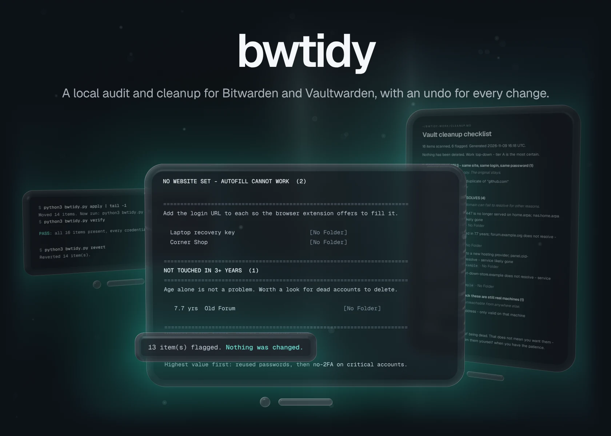</picture></a><a href="docs/readme/hero-light.webp#gh-light-mode-only"><picture><source media="(max-width: 767px)" srcset="docs/readme/hero-light-phone.webp">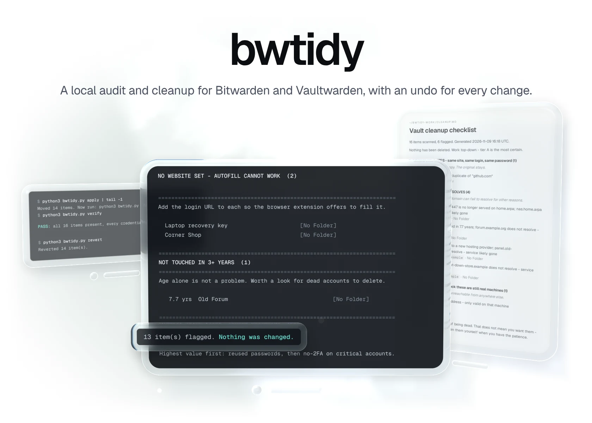</picture></a>

A password vault that has grown for years hides the same password on a bank and an old forum, logins with no second factor, three copies of one account and services that shut down long ago. bwtidy finds all of it on your own machine and fixes it with you: every change is a plan you read first, applied only when you say so, and reversible afterwards. It is nine small Python scripts on the standard library and the official `bw` CLI, and a local model in LM Studio for the folders and names.

[Quickstart](#quickstart) &nbsp;·&nbsp; [How it works](#how-it-works) &nbsp;·&nbsp; [Releases](https://github.com/gallowforge/bwtidy/releases)

<a href="docs/readme/numbers-dark.webp#gh-dark-mode-only"><picture><source media="(max-width: 767px)" srcset="docs/readme/numbers-dark-phone.webp">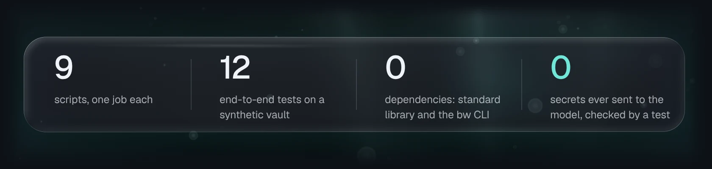</picture></a><a href="docs/readme/numbers-light.webp#gh-light-mode-only"><picture><source media="(max-width: 767px)" srcset="docs/readme/numbers-light-phone.webp">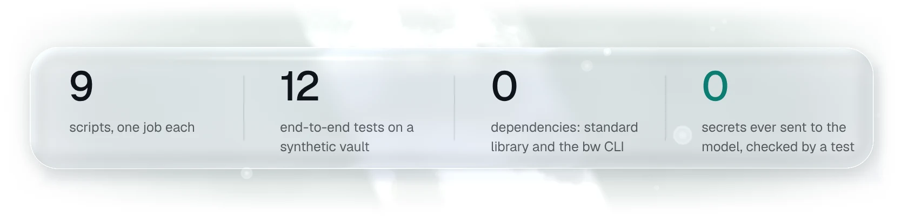</picture></a>

<a href="docs/readme/audit-dark.webp#gh-dark-mode-only"><picture><source media="(max-width: 767px)" srcset="docs/readme/audit-dark-phone.webp">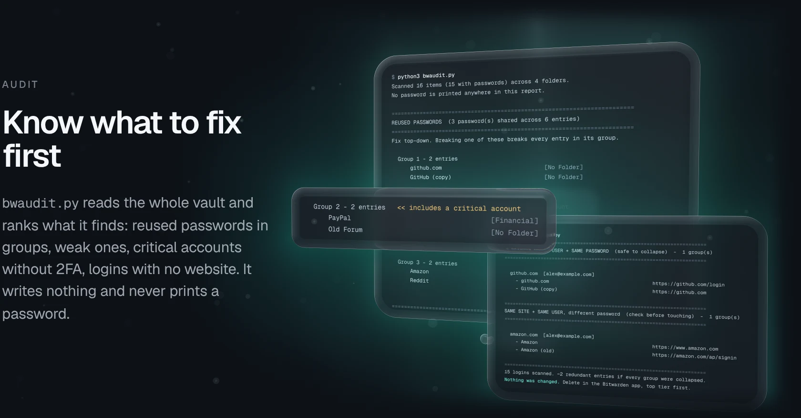</picture></a><a href="docs/readme/audit-light.webp#gh-light-mode-only"><picture><source media="(max-width: 767px)" srcset="docs/readme/audit-light-phone.webp">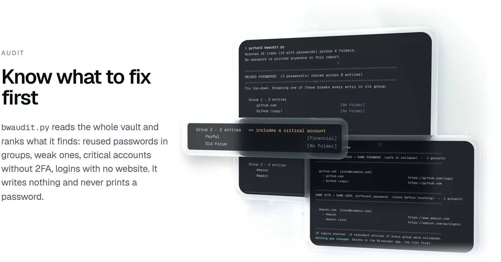</picture></a>

<a href="docs/readme/dead-dark.webp#gh-dark-mode-only"><picture><source media="(max-width: 767px)" srcset="docs/readme/dead-dark-phone.webp">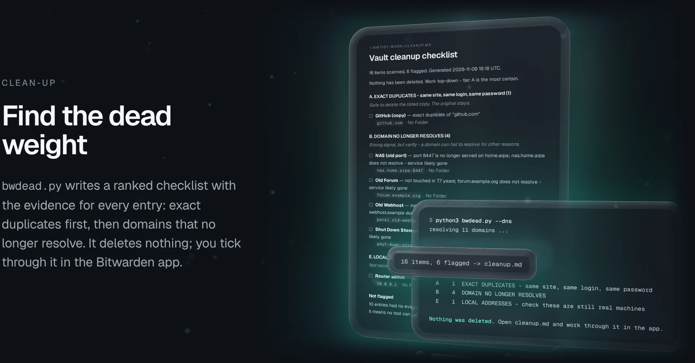</picture></a><a href="docs/readme/dead-light.webp#gh-light-mode-only"><picture><source media="(max-width: 767px)" srcset="docs/readme/dead-light-phone.webp">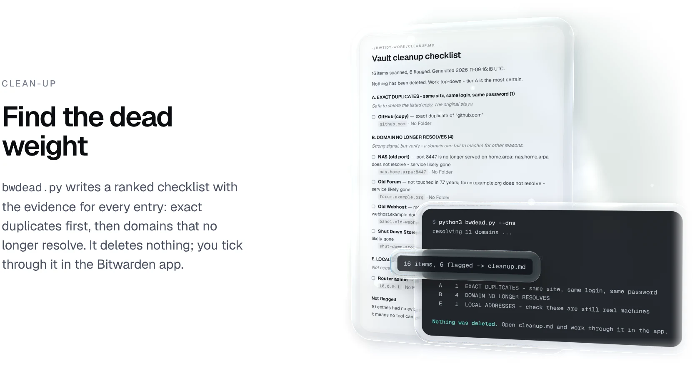</picture></a>

<a href="docs/readme/merge-dark.webp#gh-dark-mode-only"><picture><source media="(max-width: 767px)" srcset="docs/readme/merge-dark-phone.webp">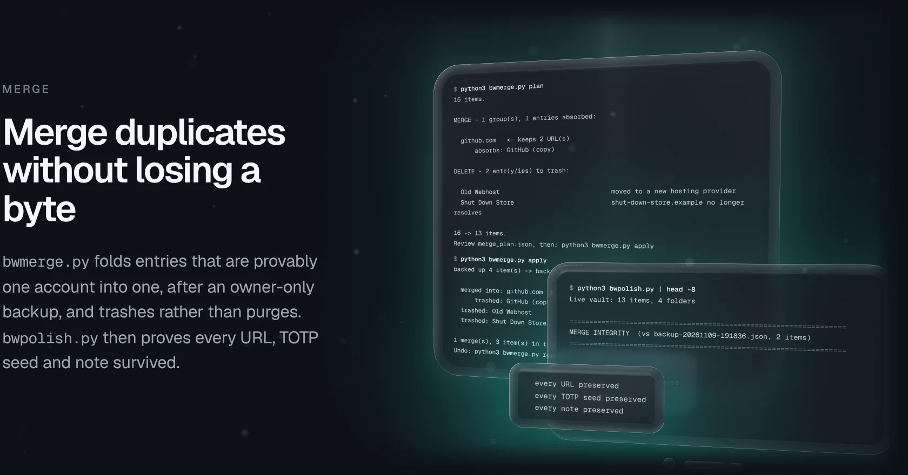</picture></a><a href="docs/readme/merge-light.webp#gh-light-mode-only"><picture><source media="(max-width: 767px)" srcset="docs/readme/merge-light-phone.webp">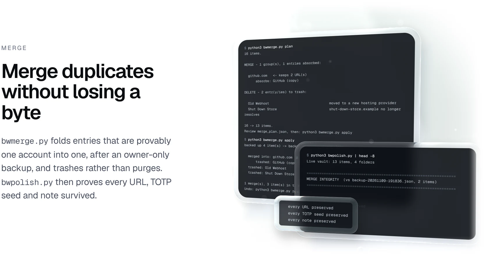</picture></a>

<a href="docs/readme/folders-dark.webp#gh-dark-mode-only"><picture><source media="(max-width: 767px)" srcset="docs/readme/folders-dark-phone.webp">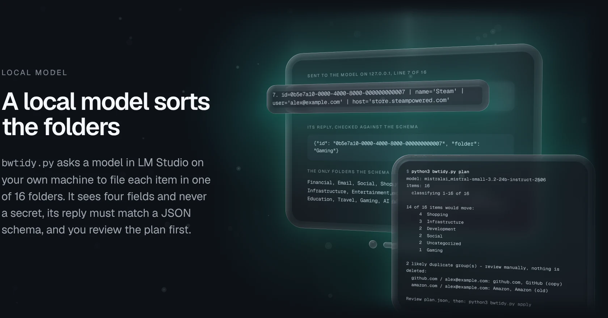</picture></a><a href="docs/readme/folders-light.webp#gh-light-mode-only"><picture><source media="(max-width: 767px)" srcset="docs/readme/folders-light-phone.webp">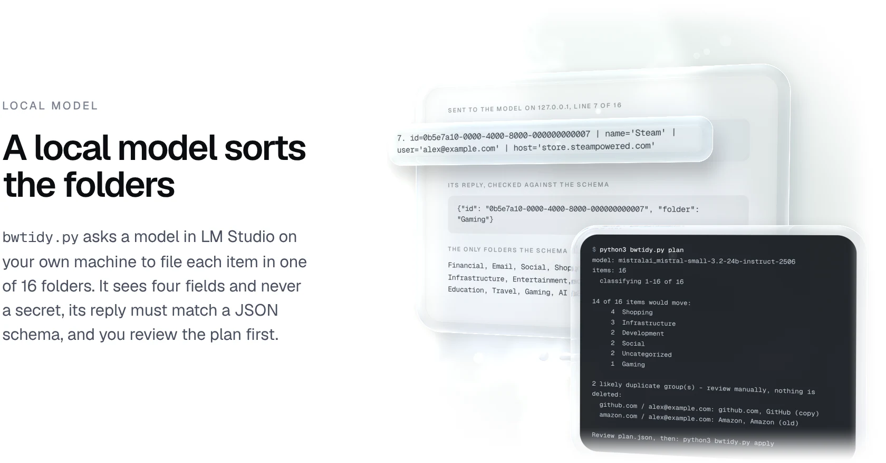</picture></a>

<a href="docs/readme/undo-dark.webp#gh-dark-mode-only"><picture><source media="(max-width: 767px)" srcset="docs/readme/undo-dark-phone.webp">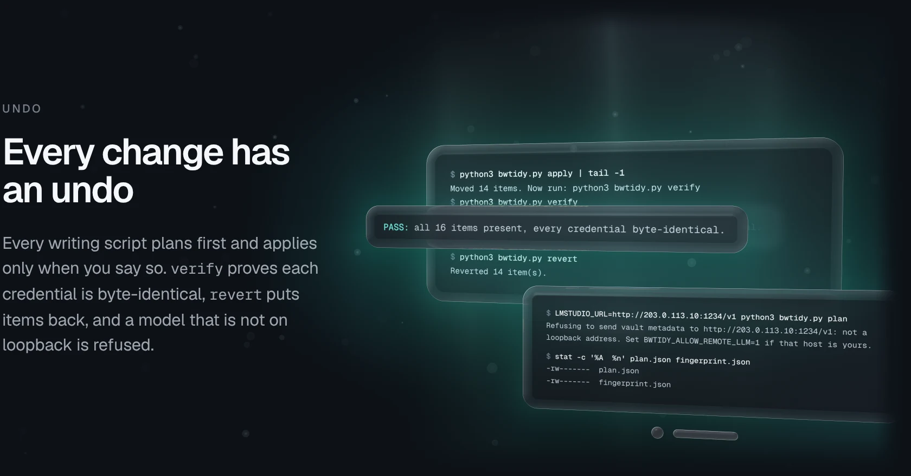</picture></a><a href="docs/readme/undo-light.webp#gh-light-mode-only"><picture><source media="(max-width: 767px)" srcset="docs/readme/undo-light-phone.webp">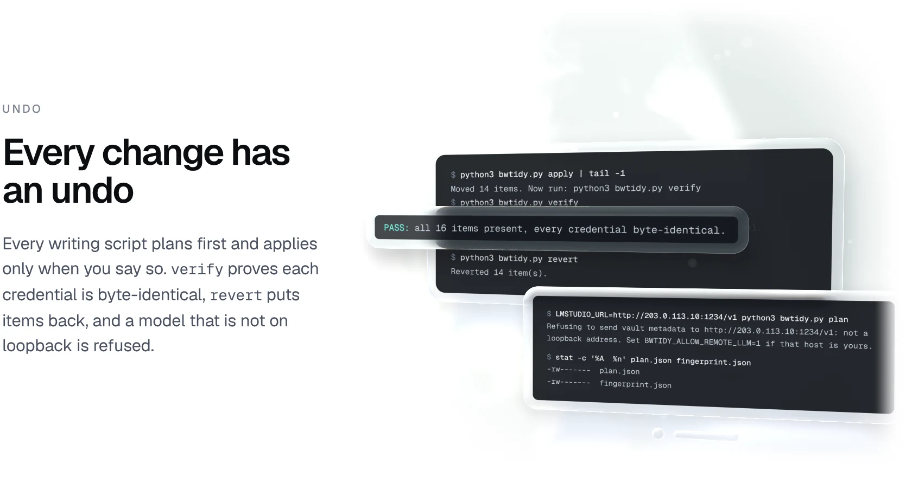</picture></a>

## Quickstart

You need Python 3.10 or newer, the [Bitwarden CLI](https://bitwarden.com/help/cli/), and [LM Studio](https://lmstudio.ai/) with its local server running for the model steps. The audit, duplicate, dead-entry and merge scripts need no model.

```sh
git clone https://github.com/gallowforge/bwtidy ~/bwtidy
mkdir -p ~/bwtidy-work && cd ~/bwtidy-work          # plans and backups land here

bw config server https://vault.example.com          # Vaultwarden only
bw login
export BW_SESSION="$(bw unlock --raw)"

cp ~/bwtidy/examples/bwtidy.example.json bwtidy.json   # optional, edit to taste
python3 ~/bwtidy/bwaudit.py                          # read-only health report
```

A typical pass: `bwaudit` and `bwdupes` to see the state; `bwtidy plan`, `apply` and `verify`; `bwrename plan` (and `bwfix` if names need repair) and `apply`; `bwmerge plan` and `apply`, then `bwpolish`; finally `bwfinal plan` and `apply`. The model defaults to `mistralai_mistral-small-3.2-24b-instruct-2506`; set `LMSTUDIO_MODEL` for another, and `LMSTUDIO_URL` if the server is not on `http://localhost:1234/v1`.

**Try it on a fake vault first.** The test fixtures include a fake `bw` and a stand-in LM Studio, so the whole workflow runs against the synthetic vault in `examples/` without touching a real one:

```sh
cd "$(mktemp -d)"
cp ~/bwtidy/examples/sample-vault.json vault.json
cp ~/bwtidy/examples/bwtidy.example.json bwtidy.json
export PATH="$HOME/bwtidy/tests/bin:$PATH" BW_SESSION=demo BW_FAKE_VAULT="$PWD/vault.json"
python3 ~/bwtidy/tests/fake_lmstudio.py 1234 &
python3 ~/bwtidy/bwaudit.py
python3 ~/bwtidy/bwtidy.py plan && python3 ~/bwtidy/bwtidy.py apply && python3 ~/bwtidy/bwtidy.py verify
```

## How it works

Each script is standalone and shares only `bwconfig.py` (configuration, the loopback check and the private umask). Report scripts call `bw list`; writing scripts call `bw edit`, `bw create`, `bw delete` (to the trash) and `bw restore`, then `bw sync`.

| Question | Method |
| --- | --- |
| How are passwords compared? | SHA-256 of each password, grouped in memory. Only item names and folders are printed. |
| What counts as weak? | Under 12 characters, or two or fewer of the four classes (lower, upper, digit, symbol). Triage, not an entropy estimate or a breach lookup. |
| Which accounts need 2FA? | Logins with no TOTP seed in Financial, Email, Infrastructure or Government & Utilities. |
| How are duplicates matched? | Registrable domain (multi-part suffixes such as `co.uk` handled; per-tenant hosts such as `github.io` kept apart) plus a normalised username (lower case, `+tag` removed). |
| When may two entries merge? | Same registrable domain, same username, same password hash, and no differing ports. The survivor is the richest entry: most URLs, then TOTP, notes, custom fields, folder, most recent edit. |
| What can be trashed? | Absorbed duplicates, and entries that match `decommissioned` or `dead_domains` in `bwtidy.json`. With `--dns`, a dead domain must also fail to resolve now. |
| How does `verify` prove nothing changed? | SHA-256 over each item's login, password, TOTP, notes, custom fields, card, identity, password history, attachments and SSH key, before the plan and after the apply. |
| What does the model see? | Folders: id, name, username, hostname. Renames add the port and a short path fragment. Replies must match a strict JSON schema; batches are retried, split, and finally defaulted to Uncategorized. |
| How is the model kept local? | `LMSTUDIO_URL` must resolve to `localhost` or a loopback address, checked before any request. Anything else exits unless `BWTIDY_ALLOW_REMOTE_LLM=1`. |
| How are written files protected? | `bwconfig.py` sets a 077 umask, so plans, fingerprints, backups and `cleanup.md` are mode 600. `.gitignore` excludes all of them. |

<details>
<summary><b>Commands</b></summary>
<br />

Run them from a working directory; plans, fingerprints and backups are written there.

| Script | Writes to vault | What it does |
| --- | --- | --- |
| `bwaudit.py` | no | Reused passwords, weak passwords, critical accounts without TOTP, logins without a URL, items untouched for 3+ years. No model. |
| `bwdupes.py` | no | Duplicate report grouped by registrable domain and normalised username, tiered by confidence. |
| `bwdead.py [--dns]` | no | Ranked deletion checklist written to `cleanup.md`: exact duplicates, dead domains, decommissioned services, stale items, local addresses. |
| `bwtidy.py plan \| apply \| verify \| revert` | yes | The model assigns every item to one of a fixed set of folders (JSON-schema constrained output). `verify` proves credentials are unchanged. |
| `bwrename.py plan \| apply \| revert` | yes | The model proposes clean names per brand group; uniqueness inside a brand is enforced by code. Only `name` is written. |
| `bwfix.py [--dry]` | no | Deterministic repair of `rename_plan.json`: strips echoed or truncated suffixes and re-disambiguates using only attributes that differ. |
| `bwmerge.py plan [--dns] \| apply \| restore [backup]` | yes | Merges entries that are provably one account; the richest entry keeps all URLs. Trashes only configured dead domains and decommissioned services. |
| `bwfinal.py plan \| apply` | yes | Reclassifies what is still in Uncategorized, adds configured URLs, converts configured non-logins to Secure Notes, drops empty folders. Backed up; undo with `bwmerge.py restore backup-final-<stamp>.json`. |
| `bwpolish.py [backup]` | no | After a merge: proves every URL, TOTP seed and note still exists, then lists remaining cosmetic issues. |

</details>

<details>
<summary><b>Configuration</b></summary>
<br />

Vault-specific knowledge lives in `./bwtidy.json` (or `$BWTIDY_CONFIG`), never in the code. Every key is optional, and unknown keys are rejected.

| Key | Used by | Meaning |
| --- | --- | --- |
| `decommissioned` | bwdead, bwmerge | `{"substring": "reason"}` matched against item name and host |
| `dead_domains` | bwmerge | The only domains `bwmerge` will trash. With `--dns` they must also fail to resolve. |
| `dns_false_positives` | bwmerge | Hosts whose plain lookup fails although the service is alive |
| `private_host` | bwdead | `{"suffix": "home.arpa", "live_ports": [443]}`: flags entries on that suffix using any other port |
| `add_url` | bwfinal | `{"exact item name": "url"}` for logins without a URL |
| `to_note` | bwfinal | Exact item names to convert to Secure Notes (username and password move into the note text) |

</details>

## Quality

| Check | What it covers |
| --- | --- |
| 12 end-to-end tests | Every script against the synthetic vault through the fake `bw` and the stand-in LM Studio: each plan, apply and undo path, tamper detection in `verify`, rename uniqueness, merge and restore, the final pass, plan files at mode 600, a refused non-loopback model, and a missing session. |
| No secrets to the model | Records every request the model receives during the folder, rename and final passes, and checks that no password, TOTP seed or note appears in any of them. |
| No network egress | Runs 17 commands with a guard that refuses and logs any connection or name lookup that is not loopback, and expects an empty log. The opt-in `--dns` check runs last to prove the guard catches it. |
| No passwords in reports | The audit test checks that none of the synthetic vault's passwords appears in the report. |
| CI | [CI](https://github.com/gallowforge/bwtidy/actions/workflows/ci.yml) byte-compiles every Python file, runs ShellCheck on any shell script, and runs the suite on every push: `python3 -m unittest discover -s tests -v`. |

## FAQ

<details>
<summary><b>Does anything leave my machine?</b></summary>
<br />
bwtidy itself opens no connection except to the model on loopback, and a test enforces that. The <code>bw</code> CLI still syncs your edits to your own Bitwarden or Vaultwarden server, end-to-end encrypted, exactly as it does without bwtidy. The one optional exception is <code>--dns</code>, which looks up each domain in your vault through your resolver.
</details>

<details>
<summary><b>Does it need my master password?</b></summary>
<br />
No. It uses the session you unlock with <code>bw unlock</code>, passed in <code>BW_SESSION</code>. The scripts never see or store the master password.
</details>

<details>
<summary><b>Will it delete my entries?</b></summary>
<br />
Only <code>bwmerge.py apply</code> deletes, and only absorbed duplicates plus what your <code>bwtidy.json</code> names as dead. Every one goes to the Bitwarden trash after a backup, and <code>bwmerge.py restore</code> brings them back. <code>bwfinal.py</code> removes only empty folders.
</details>

<details>
<summary><b>What are the limits?</b></summary>
<br />
<code>bwtidy.py revert</code> moves items back but leaves newly created folders in place. <code>bwmerge.py</code> folds URLs into the surviving entry, so if a dropped duplicate had a different note or TOTP seed, <code>bwpolish.py</code> reports it as lost and you restore and merge by hand. The strength check is triage, not a breach lookup. Backups hold full plaintext items, owner-only; delete them once you are satisfied.
</details>

<details>
<summary><b>Is the vault in these pictures real?</b></summary>
<br />
No. Every name, number and line is real output of the scripts on the synthetic vault in <code>examples/</code>, through the fake <code>bw</code> and the stand-in model in <code>tests/</code>, which answers with keyword rules but speaks the same API as LM Studio. <code>python3 scripts/readme_visuals.py</code> rebuilds them.
</details>

## Contributing

Issues and pull requests are welcome; run `python3 -m unittest discover -s tests -v` first, and use only the synthetic vault in `examples/` for tests and pictures.

## Licence

[MIT](LICENSE)
