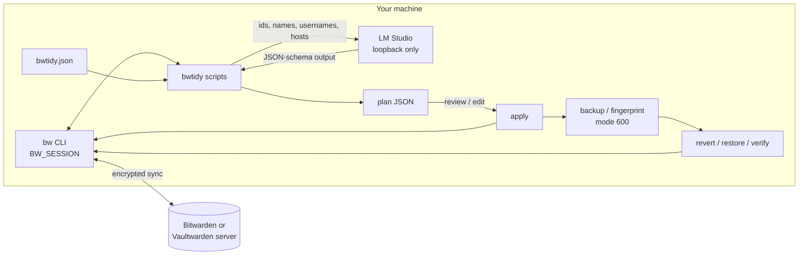

# bwtidy

Audit and clean up a Bitwarden or Vaultwarden vault from the command line, with a local LLM for folder and name suggestions and a plan, apply, revert workflow for every change.

It is a set of small, single-purpose Python scripts (standard library only) that drive the official `bw` CLI. Read-only reports come first; anything that writes to the vault produces a reviewable JSON plan, keeps a backup or an undo path, and soft-deletes only.

## Safety model

- **Local only.** All vault access goes through your own `bw` CLI session (`BW_SESSION`). The scripts never see your master password.
- **Minimal data to the model.** The LLM steps send only item ids, names, usernames and hostnames (the rename step also sends the URL port and a short path fragment) to an LM Studio server. Passwords, TOTP seeds, notes, custom fields and attachments are never sent.
- **Loopback LLM enforced.** `LMSTUDIO_URL` must resolve to `localhost` or a loopback address; anything else is refused unless you set `BWTIDY_ALLOW_REMOTE_LLM=1`.
- **No other egress by default.** The one optional exception is `--dns` on `bwdead.py` and `bwmerge.py plan`, which looks up each domain in your vault through your resolver. It is off unless you pass it.
- **Plan before apply.** Every writing script has a `plan` step that changes nothing and writes a JSON plan you can read and edit. `apply` re-reads the live vault before writing: items deleted since the plan are skipped, renames skip items renamed in the meantime, and a merge aborts if any planned item is gone.
- **Reversible.** Folder moves have `revert`, renames have `revert`, merges and deletions are backed up first and undone with `restore`. Deletes go to the Bitwarden trash, never permanent.
- **Proof, not trust.** `bwtidy.py verify` compares a SHA-256 fingerprint of every item's secret fields before and after, and fails if a single credential byte changed. `bwpolish.py` checks that no URL, TOTP seed or note was lost in a merge.
- **Files stay private.** Every file the scripts write is created with mode 600. Backups contain full plaintext items: delete them once you are satisfied. `.gitignore` excludes all of it.

## Quickstart

Requirements: Python 3.10+, the [Bitwarden CLI](https://bitwarden.com/help/cli/), and [LM Studio](https://lmstudio.ai/) with its local server running for the LLM steps.

```sh
git clone https://github.com/gallowforge/bwtidy ~/bwtidy
mkdir -p ~/bwtidy-work && cd ~/bwtidy-work          # plans and backups land here

bw config server https://vault.example.com          # Vaultwarden only
bw login
export BW_SESSION="$(bw unlock --raw)"

cp ~/bwtidy/examples/bwtidy.example.json bwtidy.json   # optional, edit to taste
python3 ~/bwtidy/bwaudit.py                          # read-only health report
```

The model defaults to `mistralai_mistral-small-3.2-24b-instruct-2506`; set `LMSTUDIO_MODEL` to use another one loaded in LM Studio, and `LMSTUDIO_URL` if the server is not on `http://localhost:1234/v1`.

### Try it without a vault

The test fixtures include a fake `bw` and a fake LM Studio, so the whole workflow runs against the synthetic vault in `examples/`:

```sh
cd "$(mktemp -d)"
cp ~/bwtidy/examples/sample-vault.json vault.json
cp ~/bwtidy/examples/bwtidy.example.json bwtidy.json
export PATH="$HOME/bwtidy/tests/bin:$PATH" BW_SESSION=demo BW_FAKE_VAULT="$PWD/vault.json"
python3 ~/bwtidy/tests/fake_lmstudio.py 1234 &
python3 ~/bwtidy/bwaudit.py
```

## Commands

Run them from a working directory; plans, fingerprints and backups are written there.

| Script | Writes to vault | What it does |
| --- | --- | --- |
| `bwaudit.py` | no | Reused passwords, weak passwords, critical accounts without TOTP, logins without a URL, items untouched for 3+ years. No model. |
| `bwdupes.py` | no | Duplicate report grouped by registrable domain and normalized username, tiered by confidence. |
| `bwdead.py [--dns]` | no | Ranked deletion checklist written to `cleanup.md`: exact duplicates, dead domains, decommissioned services, stale items, local addresses. |
| `bwtidy.py plan \| apply \| verify \| revert` | yes | LLM assigns every item to one of a fixed set of folders (JSON-schema constrained output). `verify` proves credentials are unchanged. |
| `bwrename.py plan \| apply \| revert` | yes | LLM proposes clean names per brand group; uniqueness inside a brand is enforced by code, not trusted to the model. Only `name` is written. |
| `bwfix.py [--dry]` | no | Deterministic repair of `rename_plan.json`: strips echoed or truncated suffixes and re-disambiguates using only attributes that differ. |
| `bwmerge.py plan [--dns] \| apply \| restore [backup]` | yes | Merges entries that are provably one account (same domain, username and password, no differing ports); the richest entry keeps all URLs. Trashes only configured dead domains and decommissioned services. |
| `bwfinal.py plan \| apply` | yes | Reclassifies what is still in Uncategorized, adds configured URLs, converts configured non-logins to Secure Notes, drops empty folders. Backed up; undo with `bwmerge.py restore backup-final-<stamp>.json`. |
| `bwpolish.py [backup]` | no | After a merge: proves every URL, TOTP seed and note still exists, then lists remaining cosmetic issues. |

A typical pass: `bwaudit` and `bwdupes` to see the state, `bwtidy plan/apply/verify`, `bwrename plan` (and `bwfix` if names need repair), `bwrename apply`, `bwmerge plan/apply`, `bwpolish`, `bwfinal plan/apply`.

### Configuration

Vault-specific knowledge lives in `./bwtidy.json` (or `$BWTIDY_CONFIG`), never in the code. Every key is optional:

| Key | Used by | Meaning |
| --- | --- | --- |
| `decommissioned` | bwdead, bwmerge | `{"substring": "reason"}` matched against item name and host |
| `dead_domains` | bwmerge | The only domains `bwmerge` will trash. With `--dns` they must also fail to resolve. |
| `dns_false_positives` | bwmerge | Hosts whose plain lookup fails although the service is alive |
| `private_host` | bwdead | `{"suffix": "home.arpa", "live_ports": [443]}`: flags entries on that suffix using any other port |
| `add_url` | bwfinal | `{"exact item name": "url"}` for logins without a URL |
| `to_note` | bwfinal | Exact item names to convert to Secure Notes (username and password move into the note text) |

## Example output

From the synthetic vault in `examples/sample-vault.json`:

```text
$ python3 bwaudit.py
Scanned 16 items (15 with passwords) across 3 folders.
No password is printed anywhere in this report.

========================================================================
REUSED PASSWORDS  (2 password(s) shared across 4 entries)
========================================================================
Fix top-down. Breaking one of these breaks every entry in its group.

  Group 1 - 2 entries
      github.com                               [No Folder]
      GitHub (copy)                            [No Folder]

  Group 2 - 2 entries
      Amazon                                   [No Folder]
      Reddit                                   [No Folder]

========================================================================
NO SECOND FACTOR ON A CRITICAL ACCOUNT  (1)
========================================================================
Bitwarden can store the TOTP seed itself - add it on the site, then paste the seed here.

  PayPal                                   [Financial]
...
11 item(s) flagged. Nothing was changed.
```

```text
$ python3 bwmerge.py plan
16 items.

MERGE - 1 group(s), 1 entries absorbed:

  github.com   <- keeps 2 URL(s)
      absorbs: GitHub (copy)

DELETE - 2 entr(y/ies) to trash:

  Legacy IPTV                              IPTV - replaced by a streaming service
  Shut Down Store                          shut-down-store.example no longer resolves

16 -> 13 items.
Review merge_plan.json, then: python3 bwmerge.py apply

$ python3 bwmerge.py apply
backed up 4 item(s) -> backup-<stamp>.json
  merged into: github.com  (2 URLs)
      trashed: GitHub (copy)
  trashed: Legacy IPTV
  trashed: Shut Down Store

1 merge(s), 3 item(s) in trash.
Undo: python3 bwmerge.py restore   (backup: backup-<stamp>.json)
```

```text
$ python3 bwtidy.py plan && python3 bwtidy.py apply >/dev/null && python3 bwtidy.py verify
model: mistralai_mistral-small-3.2-24b-instruct-2506
items: 16
  classifying 1-16 of 16

15 of 16 items would move:
     4  Shopping
     2  Development
     2  Social
     2  Entertainment
     2  Infrastructure
     2  Uncategorized
     1  Email
...
PASS: all 16 items present, every credential byte-identical.
```

## Architecture



Each script is standalone and shares only `bwconfig.py` (configuration, the loopback check, and the private umask). Report scripts call `bw list`; writing scripts call `bw edit`, `bw create`, `bw delete` (trash) and `bw restore`, then `bw sync`.

## Tests

```sh
python3 -m unittest discover -s tests -v
```

Ten end-to-end tests run every script against the synthetic vault through `tests/bin/bw` (a fake CLI backed by a JSON file) and `tests/fake_lmstudio.py` (keyword rules instead of a model). They cover each plan, apply and undo path, tamper detection in `verify`, that no password appears in report output, that plan files are mode 600, and that a non-loopback LLM URL is refused. CI also byte-compiles every Python file.

## Limitations

- The LLM steps were built against LM Studio's OpenAI-compatible API with structured output; other servers that implement `response_format: json_schema` should work but are untested.
- `bwtidy.py revert` moves items back but leaves newly created folders in place; `bwfinal.py` drops empty folders.
- `bwmerge.py` folds URLs into the surviving entry. If a dropped duplicate had a different note or TOTP seed, `bwpolish.py` reports it as lost; restore and merge by hand.
- Strength checks are triage (length and character classes), not an entropy estimate or a breach lookup.

## License

MIT
